# MECM Packaging Manager

**Version 4.7.0** — software and driver catalogues, BIOS hubs (HP/Dell/Lenovo) with vendor tools in ZIPs, per-module ACL, per-user lab VM, security checks, ZIP packages, MECM publication, renewal mailing.

A web tool to industrialize Windows packaging for Configuration Manager: software catalogue, driver packs, BIOS configuration packages, silent-install recipes, security checks, lab testing, then publication (Software Center, Driver Package, or task sequence).

Public overview: `/welcome` (FR) · `/welcome/en` (EN)  
Release notes: [`CHANGELOG.md`](CHANGELOG.md)

## Live demo

Try the app without installing anything:

| | |
|---|---|
| **URL** | [https://sccm-automation.borninthe80s.fr/](https://sccm-automation.borninthe80s.fr/) |
| **Sign-in** | `admin@mecmpackagingmanager.com` |
| **Password** | `admin@mecmpackagingmanager.com` |

Shared demo account — for exploration only. Change credentials on your own instance after install.

## Modules at a glance

| Module | Status | What it does |
|---|---|---|
| **Software** | Stable | Catalogue, sync (SHA-256), packaging wizard, VirusTotal, ZIP + `deploy.ps1`, per-user lab VM test |
| **Drivers** | Beta | Dell KB + HP SoftPaq matrix — version check without downloading multi-GB packs; light ZIP + `deploy-drivers.ps1` |
| **BIOS** | Beta | HP / Dell / Lenovo hubs: versioned configs + Apply scripts with vendor tools embedded in the download ZIP |
| **Settings** | Admin | Tabs: General / Software / Drivers / BIOS (SMTP, VirusTotal, MECM, categories, BIOS log paths…) |
| **Users & ACL** | Admin | Roles + per-brick access: Softwares / Drivers / BIOS → none / read / write |
| **Logs** | Admin only | Audit trail of sign-in, syncs, ZIPs, VM tests, settings changes |

## Screenshots

All captures below are from the live demo (v4.2.0 / UI current as of screenshots).

### Welcome (French)

Public landing page before sign-in.

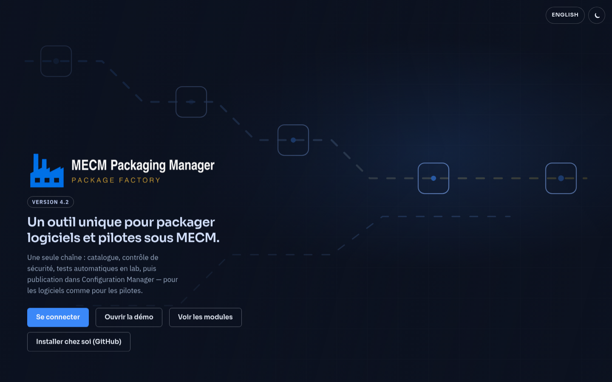

### Welcome (English)

Same page with the English overlay (`/welcome/en`).

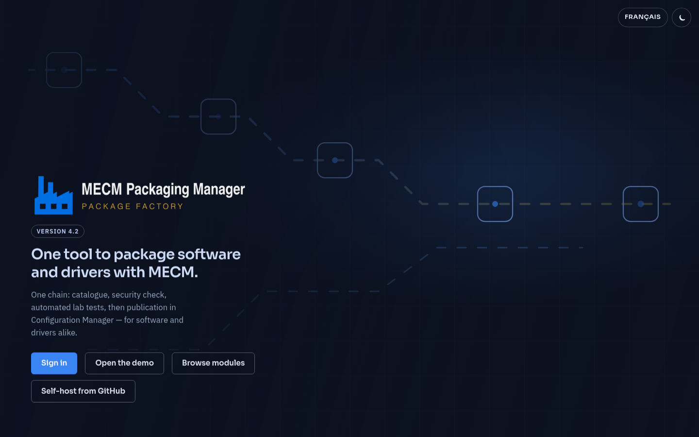

### Sign-in

Email / password form. Dark mode toggle is available on every public page.

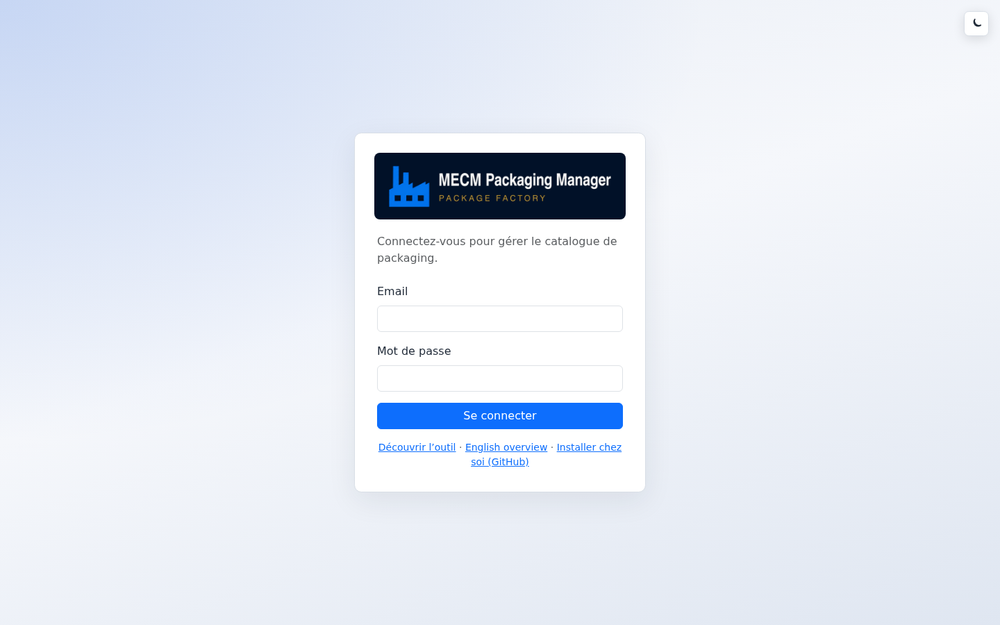

### Dashboard

Software and driver catalogue overview: counts, overdue items, and shortcuts to create a record.

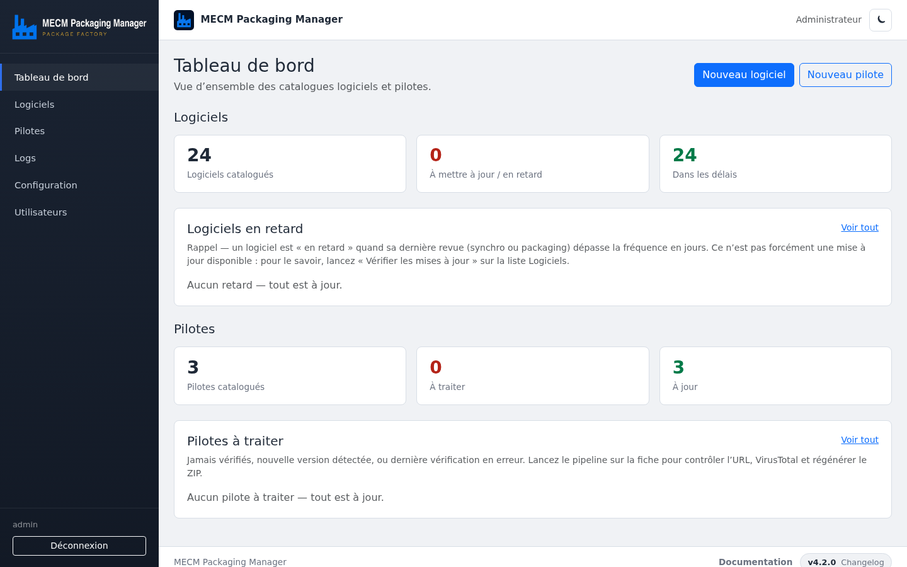

### Software catalogue

Search, filters, last packaging date, and the Sync status column.

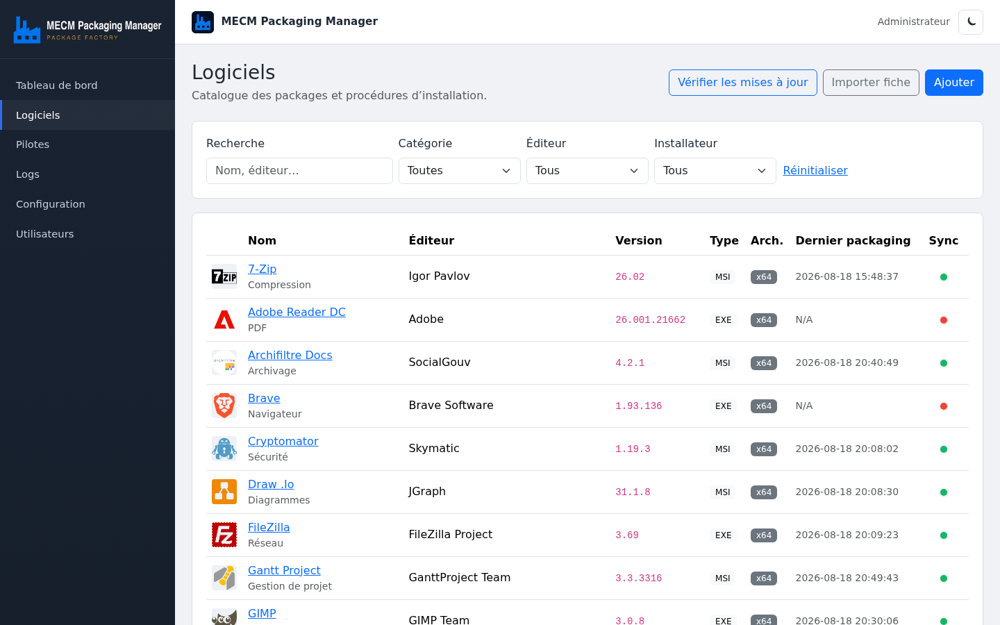

### Software record

Example **7-Zip** fiche: version, SHA-256, pipeline (sync → VirusTotal → ZIP → lab VM), installer upload, MECM 512×512 icon.

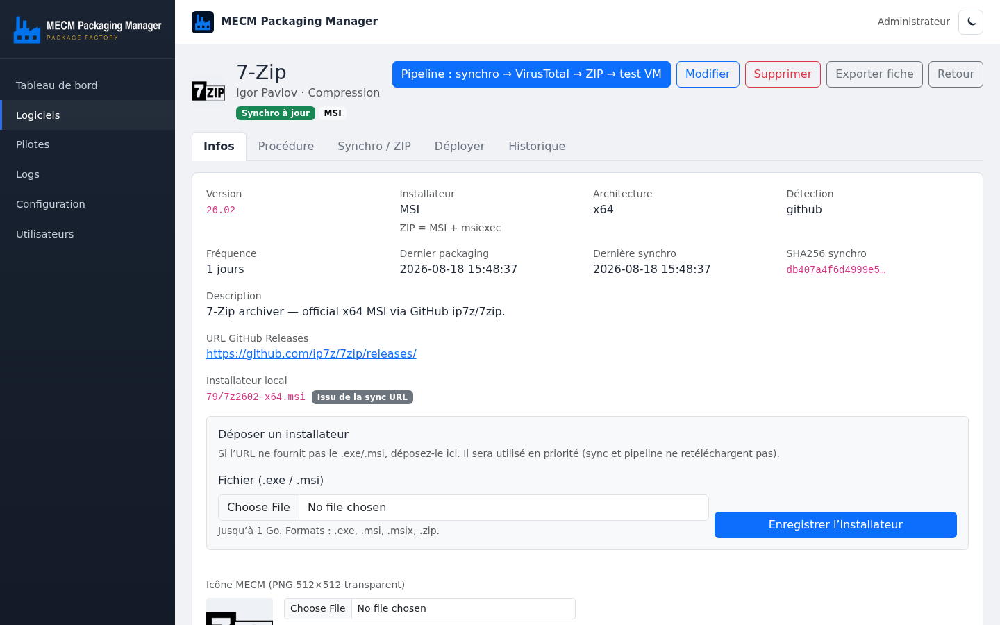

### Driver catalogue

Dell KB pages and HP SoftPaq matrix entries. Version for HP is shown as `4.00 A 1 (SP168972)` — the app never downloads the multi-GB pack.

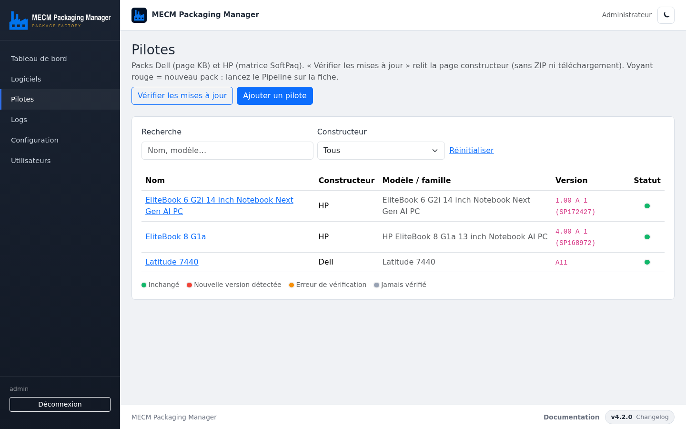

### Driver record

HP EliteBook pack: matrix URL, Windows 11 column, SoftPaq EXE, generated ZIP (`deploy-drivers.ps1` + `driver.json` only).

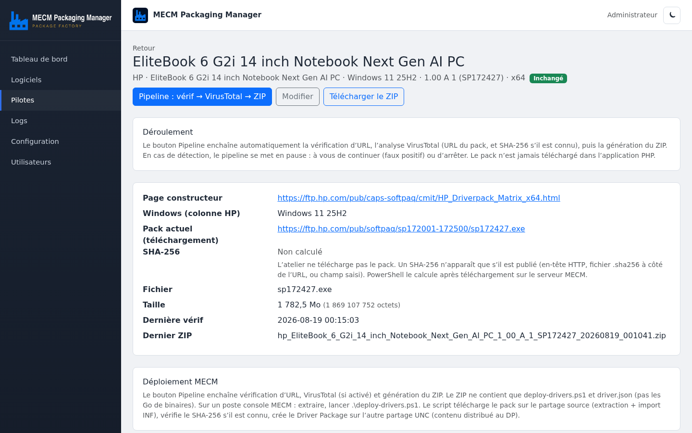

### New HP driver

Form with manufacturer **HP**, model, Windows 11 column, and the official SoftPaq matrix URL.

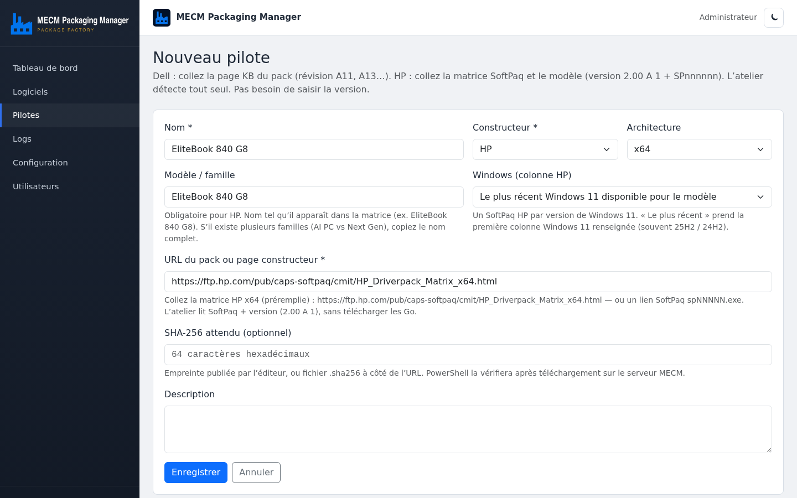

### In-app documentation

User guide covering software, Dell / HP drivers, BIOS hubs (HP / Dell / Lenovo), VirusTotal, renewal mailing, and MECM import after the ZIP.

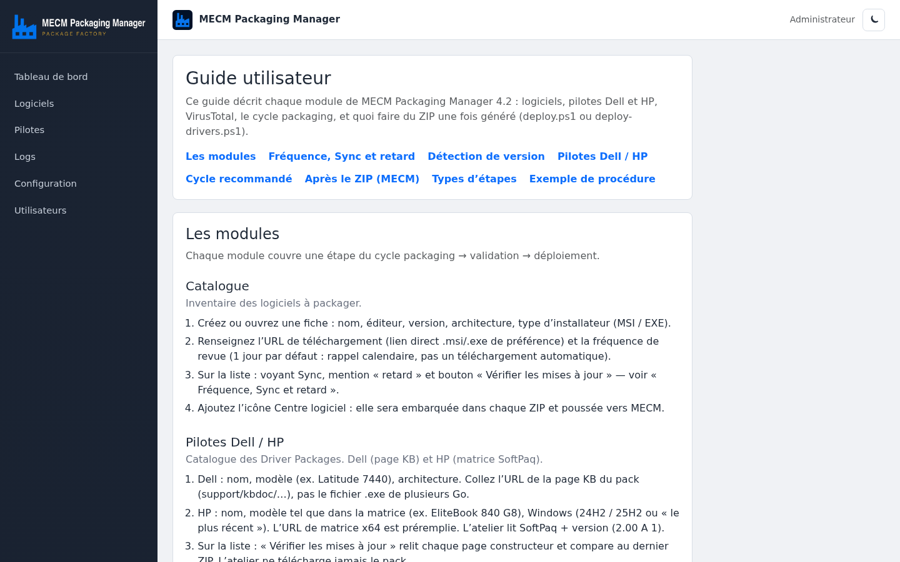

### Settings

Admin Configuration with **module tabs** (General / Software / Drivers / BIOS): language, permissions check, VirusTotal, SMTP mailing, MECM targets, categories, BIOS log paths. Lab VM is configured per user under the account menu.

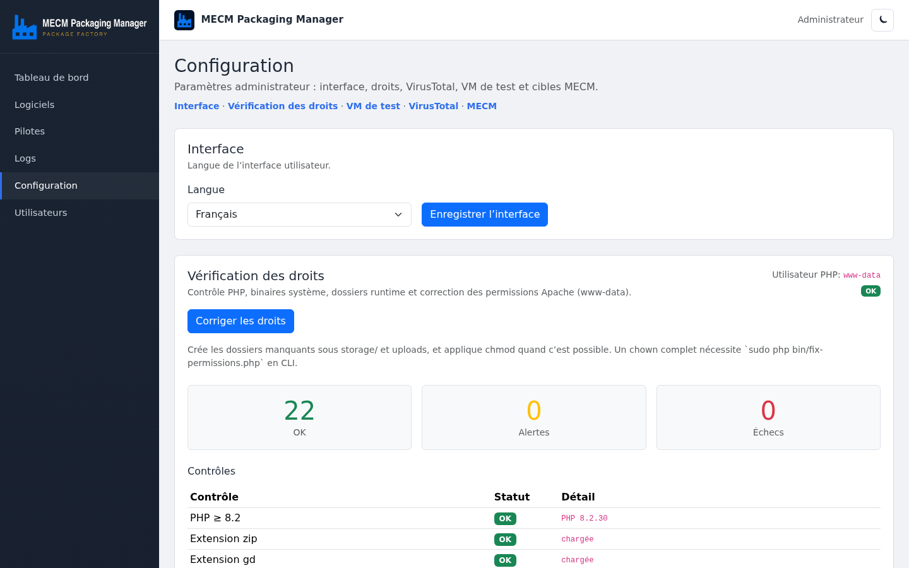

### Audit log

User and pipeline actions: sign-in, driver sync, ZIP generation, update detections (administrators only).

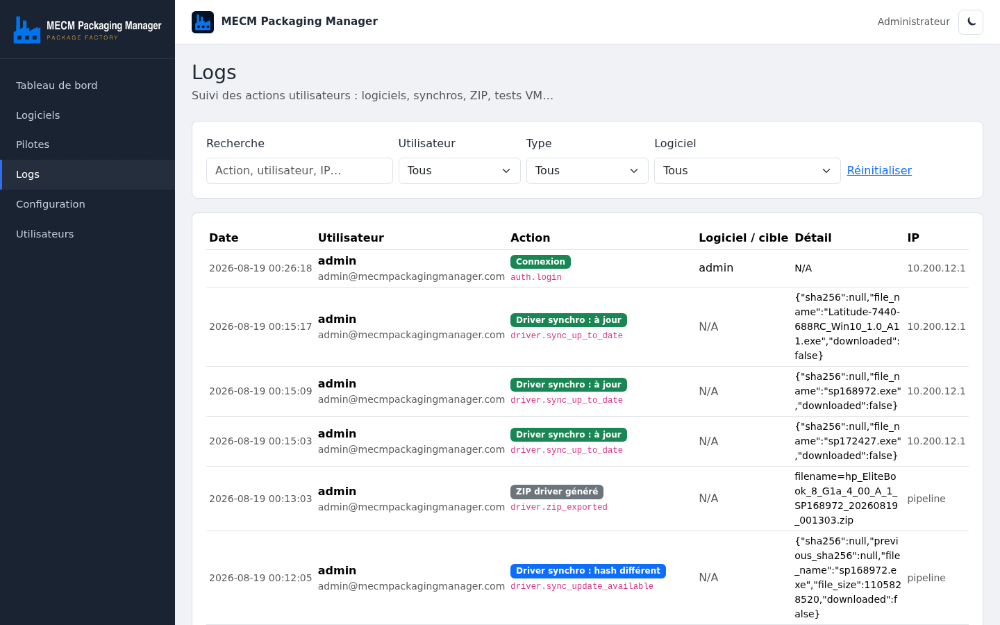

## Default credentials

On first install, an admin account is seeded from `config/auth.php` / Compose env (override with `ADMIN_EMAIL` / `ADMIN_PASSWORD_HASH`):

| | |
|---|---|
| **Email** | `admin@mecmpackagingmanager.com` |
| **Password** | `admin@mecmpackagingmanager.com` |

Change this password under **Users** after install. Production: set `ADMIN_EMAIL` / `ADMIN_PASSWORD_HASH` in `.env` (never commit `.env` or real instance hashes). If the seed email already exists, nothing is overwritten.

## Requirements

- Docker Engine + Compose v2 **or** PHP ≥ 8.2 + Apache (`mod_rewrite`) + Composer
- ImageMagick (`magick` or `convert`) and librsvg (`rsvg-convert`) for MECM 512×512 icons
- Lab tests: SSH + `sshpass` to a Windows VM (configured **per user**)
- For `deploy.ps1` / `deploy-drivers.ps1`: a workstation with the PowerShell **ConfigurationManager** module

## Quick start (Docker)

```bash
git clone https://github.com/mike37510/mecm-packaging-manager.git
cd mecm-packaging-manager
cp .env.example .env   # optional: ADMIN_*, ports, HOST_DATA_ROOT
docker compose up -d --build
```

- App: http://localhost:8080
- SSH into the container (lab): `ssh -p 2222 admin@localhost` (default password: `admin`, override `SSH_PASSWORD`)

Compose persistent data is created **on the host** under `docker-data/` (not in git, see `.gitignore`) and mounted onto `storage/` in the container.

Image / volumes: [`docker/README.md`](docker/README.md).

## Install without Docker

```bash
composer install
sudo php bin/fix-permissions.php --migrate
```

Apache DocumentRoot: **`public/`** (not the repository root).

`bin/fix-permissions.php` creates `storage/`, uploads, and the admin account if missing.  
In the UI: **Settings** → **Permissions check**.

## What not to commit

A `.gitignore` is provided. Keep out of git:

- `vendor/`
- `storage/data/`, `storage/packages/`, `storage/exports/`, `storage/jobs/`, `storage/backups/`, `storage/bios/`, `storage/logs/`, `storage/cache/` (except `.gitkeep`)
- `docker-data/`
- `backup/`
- `public/assets/uploads/icons/*` (except `.gitkeep`)
- `config/*.local.php` (keep `*.example`)
- `.env`

Code and recipes (`src/`, `templates/`, `config/auth.php` with the hash, `docker-compose.yml`) belong in git. Installers and ZIP archives do not.

## Configuration

| Topic | Where |
|---|---|
| Admin account (seed) | `config/auth.php` or `ADMIN_EMAIL` / `ADMIN_PASSWORD_HASH` / `ADMIN_DISPLAY_NAME` |
| App data | `storage/data/*.json` (or `docker-data/data/` with Compose) |
| Lab VM (per user) | Account menu → **Lab VM** (`/account/vm`) — users with Software **write** |
| Account password | Account menu → **Change password** |
| MECM (site, DP, drivers UNC) | **Settings** tabs → `storage/data/mecm_config.json` |
| BIOS log paths | **Settings** → BIOS → `storage/data/bios_config.json` |
| BIOS configs / ZIPs | `storage/bios/{hp,dell,lenovo}/` |
| Module ACL | **Users** (modal) → Softwares / Drivers / BIOS |

Generate a new admin hash (seed only — an existing account keeps the password set in the UI):

```bash
php -r "echo password_hash('NewPassword', PASSWORD_DEFAULT), PHP_EOL;"
```

In `docker-compose.yml`, every `$` in the bcrypt hash must be written `$$`.

## Features

### Software

- One URL per product: direct `.exe`/`.msi` link or GitHub Releases page
- Optional **documentation URL** pushed to MECM Software Center (instead of the installer URL)
- **Categories** managed under Settings → Software (dropdown on software forms)
- Wizard: paste the URL → fetch the installer → pre-filled MSI/EXE commands
- SHA-256 sync; clear UI distinction **synced version** vs **packaged version** (last ZIP)
- Manual installer upload (up to ~1 GB) when the URL cannot serve the file
- Pipeline: sync → VirusTotal → ZIP → **lab VM** (operator confirmation)
- `deploy.ps1` for applications (Software Center)

### Drivers (beta)

- Catalogue of **Driver Packages** for Dell and HP (module marked beta)
- **Dell**: paste the model support / KB page — the app reads the current pack revision without downloading the CAB/ZIP
- **HP**: paste the [SoftPaq matrix x64](https://ftp.hp.com/pub/caps-softpaq/cmit/HP_Driverpack_Matrix_x64.html), the **model**, and the **Windows 11** column (or “latest”). Version shown as `4.00 A 1 (SP168972)`
- Sync / “Check for updates” compares SoftPaq id + version + URL to the last ZIP — **never** pulls multi-GB binaries into PHP
- Pipeline builds a **light ZIP** (`driver.json` + `deploy-drivers.ps1`); the pack is fetched later on the MECM admin workstation
- `deploy-drivers.ps1` extracts Dell CAB/ZIP and HP SoftPaq EXE (`/s /e /f`) into a Driver Package
- Settings → Drivers: UNC source / package shares and MECM driver category

### BIOS (beta)

- Hub `/bios` with three manufacturers (module marked beta):
  - **HP** — BCU-style editor → versioned `BiosHP-N.cfg` + CMSL scripts (`Apply` / Clear Setup password / Get-All). ZIP embeds `Modules/` (CMSL) when present under `resources/bios/hp/`
  - **Dell** — CCTK editor → versioned `BiosDell-N.ini` (`[cctk]`). ZIP embeds `tools/` (`cctk.exe` + DLLs) when present under `resources/bios/dell/`
  - **Lenovo** — TBCT editor (`SettingName,Value`) → versioned `BiosLenovo-N.ini`. ZIP embeds `Lenovo.BIOS.Config` when present under `resources/bios/lenovo/`
- Download package = config + Apply/Clear/Get PowerShell + vendor tool tree (no more `PLACE_*` placeholders when binaries are on the server)
- Settings → BIOS: local log path + UNC share injected into Apply scripts
- Generated BIOS passwords use an **AZERTY/QWERTY-safe** character set

### Security, accounts, operations

- **VirusTotal** in software and driver pipelines (URL + SHA-256 when known); operator pause on a malicious verdict
- **Renewal mailing**: SMTP under Settings → General; e-mail to last packager when review frequency is exceeded (`bin/send-renewal-mails.php`, Docker cron)
- **Per-user lab VM** (`/account/vm`): host, SSH port, credentials, remote directory — required for Software write users who run VM tests
- **Account menu** (top-right): change password, lab VM, sign out
- **Roles** admin / operator / viewer + **per-module ACL** (none / read / write) on Softwares, Drivers, BIOS
- Logs menu restricted to administrators
- CSRF, audit log, permissions check (PHP extensions, `magick`/`convert`, `rsvg-convert`, SSH tools, folders)

### MECM hand-off

- `deploy.ps1` — applications → Software Center
- `deploy-drivers.ps1` — Driver Packages
- BIOS Apply scripts — task sequence or package on a machine with the vendor tool
- In-app docs (`/docs`): frequency vs overdue vs Sync, Dell / HP detection, BIOS hubs, VirusTotal, MECM import

## Sample catalogue: 7-Zip

A ready-to-import example (no installer binary) lives in [`examples/7-Zip/`](examples/7-Zip/):

1. **Software** → **Import recipe** → upload `examples/7-Zip/7-Zip.json`
2. Open the record → **Sync** to fetch the official x64 MSI from GitHub
3. Optional: upload `examples/7-Zip/icon.png` as the Software Center icon
4. Generate the ZIP / test on your personal lab VM (Account → Lab VM)
